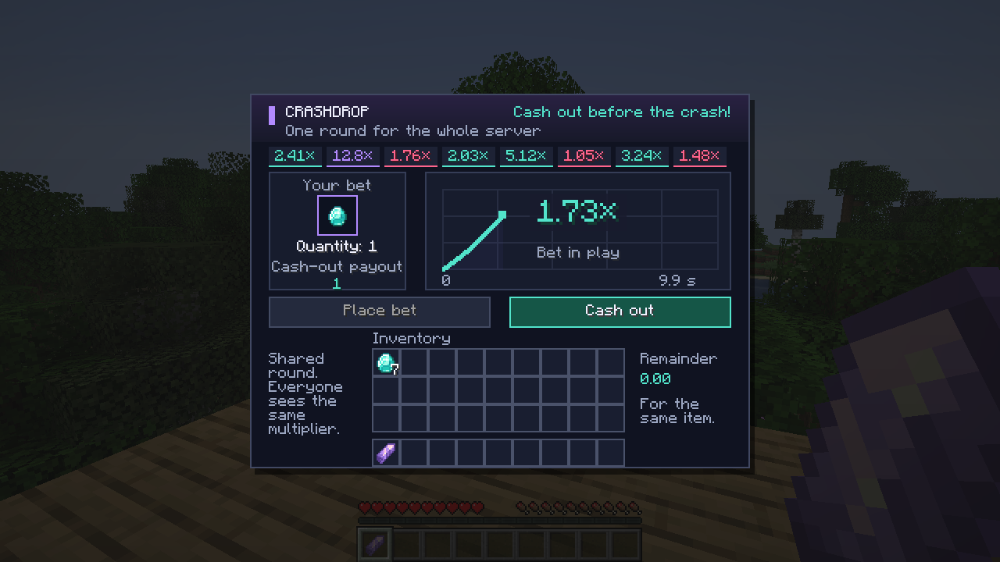
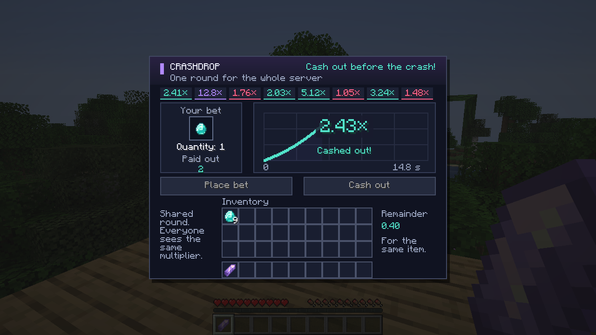
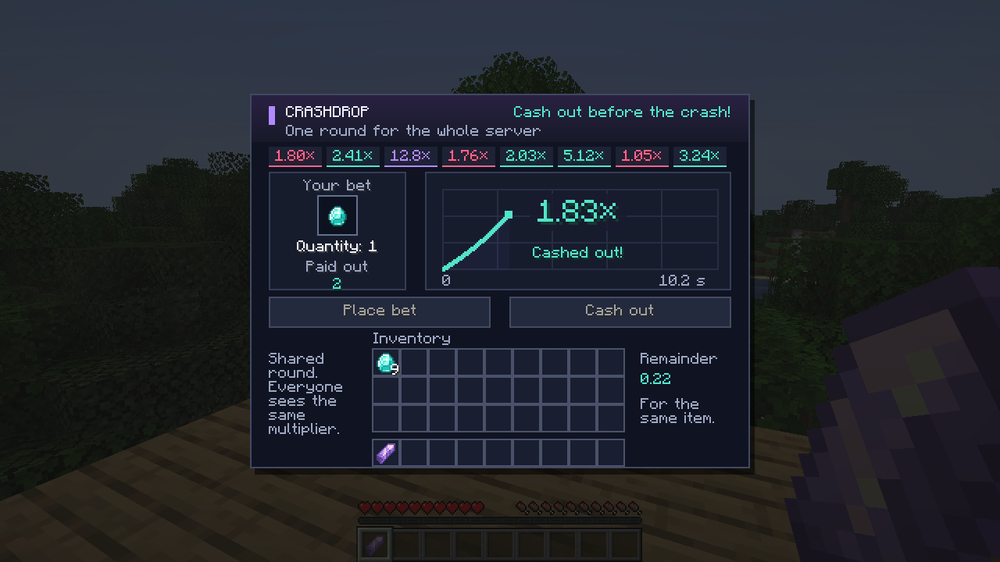
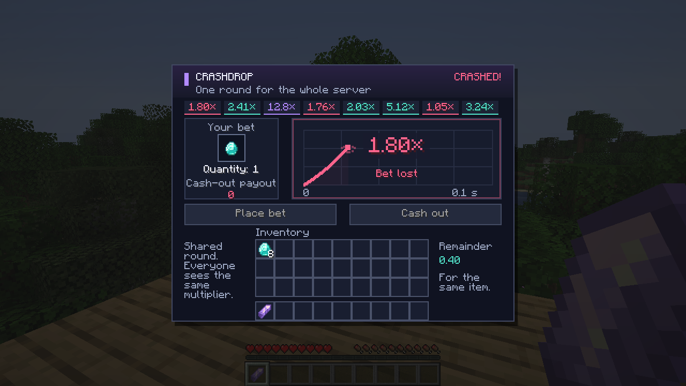

# CrashDrop

CrashDrop adds one item — the CrashDrop Terminal. Right-click it to open a shared item-stake game: place a stake, watch the multiplier rise, and cash out before the round crashes.

[Download 0.1.0](https://github.com/CoreX3D/crashdrop-fabric-26.3/releases/tag/v0.1.0) · [All releases](https://github.com/CoreX3D/crashdrop-fabric-26.3/releases) · [Changelog](CHANGELOG.md)



**Watch the multiplier and cash out before the crash.**
**Следи за множителем и успей вывести до краша.**

## Requirements and installation

- Minecraft **26.3**, Java **25**.
- Fabric Loader **0.19.5+** and Fabric API **0.164.0+26.3** or a newer release for **26.3**.
- Install the CrashDrop JAR in `mods` on both client and server. In singleplayer, install it on the client.

**CrashDrop works independently. IC2 and Upgrader are not required.** This is a Fabric mod; a Bukkit/Paper plugin loader cannot load it.

## How to play

Craft the terminal with iron ingots in the four corners, redstone dust on the four edges, and an emerald in the centre. Right-click the terminal to open the menu. An operator can also use `/give @s crashdrop:terminal`.

1. Put items in the left slot and press **Place bet** during the 10-second betting phase.
2. The multiplier starts at **×1** and rises smoothly. Everyone on the server sees the same round and crash.
3. Press **Cash out** before the crash. One diamond cashed out at **×2** pays two diamonds; a crash before cash-out consumes the stake.

The default maximum is **×64**. Higher multipliers are rarer: approximately 40% of rounds reach ×2, 16% reach ×4, and 6.5% reach ×8. The maximum itself is a crash boundary, so cash out earlier. The server decides when a cash-out is accepted.

Fractional payouts accumulate for the exact same item and components. One diamond at ×1.80 pays one diamond and saves 0.80; a later payout of 1.40 adds up to two diamonds with 0.20 left. Names, enchantments, durability, charge, and other item components are preserved. Leftover fractions and unclaimed payouts are saved with the world.

Closing the menu or disconnecting does not cancel an accepted bet. Items in the input slot that have not been bet are returned. Unresolved stakes are refunded on a normal server shutdown.

## In-game gallery / Галерея из игры

### Cash out / Вывод выигрыша

One diamond staked, two diamonds paid out, and a saved fractional remainder.
Один алмаз в ставке, два алмаза в выплате и сохранённый дробный остаток.



### Fractions add up / Остатки складываются

The next successful cash-out uses the saved fraction and keeps the new remainder for later.
Следующий успешный вывод учитывает накопленную дробную часть и сохраняет новый остаток.



### Crash / Краш

If you do not cash out in time, the round crashes and the active stake is lost.
Если не успеть вывести, раунд завершается крашем и активная ставка сгорает.



## Configuration

The server creates `config/crashdrop.json`. Restart the server after editing it.

| Setting | Default | Purpose |
|---|---:|---|
| `houseEdge` | `0.03` | Parameter used to choose crash points |
| `maxMultiplier` | `64` | Upper crash boundary |
| `growthPerSecond` | `0.06` | Exponential multiplier growth rate |
| `maxStakeItems` | `64` | Maximum items in one stake |
| `maxPayoutItems` | `4096` | Maximum whole items in one payout |
| `blacklist` | Item IDs | Items that cannot be staked |

For a multiplier below the cap, the approximate chance to reach `x` is `(1 - houseEdge) / x^1.3`, discretized to hundredths. The `houseEdge` value does not promise a fixed return for every strategy.

## Build and validation

Use JDK 25 and the included Gradle Wrapper:

```shell
./gradlew build
```

On Windows, run `.\gradlew.bat build`. The mod is produced in `build/libs`. Game tests can be enabled with `-PenableGameTests=true`.

See [validation details](docs/VALIDATION.md) for the release checks. All four screenshots above are unedited captures of the actual Minecraft interface.

## Русский

**CrashDrop** добавляет один предмет — Пульт CrashDrop. ПКМ открывает игру с общим для сервера раундом: поставь предметы, следи за растущим множителем и нажми **«Вывести»** до краша.

[Скачать 0.1.0](https://github.com/CoreX3D/crashdrop-fabric-26.3/releases/tag/v0.1.0)

Нужны **Minecraft 26.3**, **Java 25**, **Fabric Loader 0.19.5+** и **Fabric API 0.164.0+26.3** либо более новая версия API для 26.3. Положи JAR в `mods` клиента и сервера; для одиночной игры достаточно клиента. **IC2 и Апгрейдер не требуются.** Это мод Fabric, а не плагин Bukkit/Paper.

Крафт пульта: железные слитки в четырёх углах, красная пыль по четырём сторонам, изумруд в центре. Рецепт появляется в зелёной книге после получения изумруда. Команда для оператора: `/give @s crashdrop:terminal`.

Во время 10-секундного приёма ставок положи предметы в левую ячейку и нажми **«Поставить»**. Затем множитель плавно растёт от ×1. Один алмаз при выводе на ×2 превращается в два. Если краш произошёл до обработки вывода сервером, ставка сгорает. Все игроки видят один множитель и один краш.

По умолчанию предел — **×64**, высокие множители встречаются реже. До ×2 доходит примерно 40% раундов, до ×4 — 16%, до ×8 — 6,5%. На самом пределе происходит краш: вывести нужно раньше.

Дробная часть сохраняется для такого же предмета со всеми его компонентами: 1 алмаз ×1,80 даёт 1 алмаз и остаток 0,80. Следующая выплата 1,40 вместе с остатком даст 2 алмаза и новый остаток 0,20. Сохраняются зачарования, имя, износ, заряд и другие данные. Остатки и невместившиеся выплаты записываются в мир.

Закрытие меню и выход с сервера не отменяют принятую ставку. Непоставленные предметы из входной ячейки возвращаются. При штатной остановке сервера незавершённые ставки возвращаются игрокам.

Настройки находятся в `config/crashdrop.json`; после изменений нужен перезапуск. В таблице выше перечислены предел множителя, скорость роста, лимиты ставки и выплаты, список запрещённых предметов и параметр распределения краша. Интерфейс переведён на русский и английский.

## License

[MIT](LICENSE)
